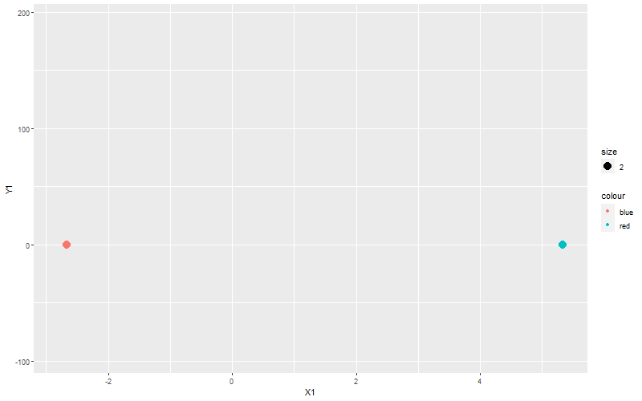
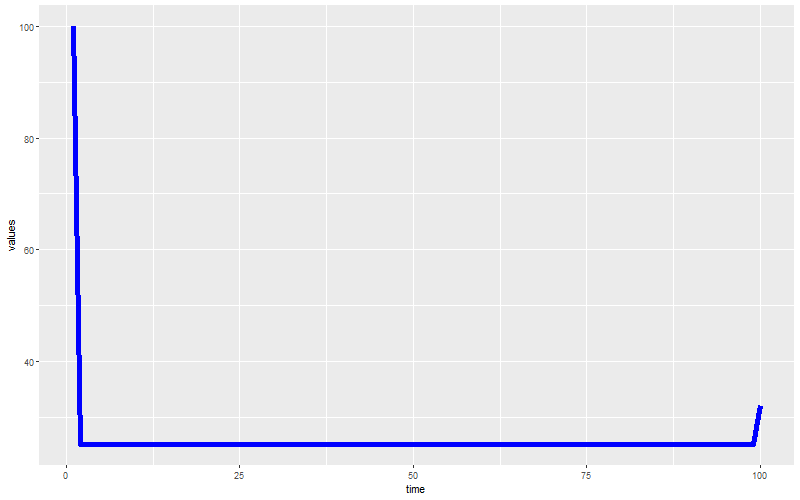
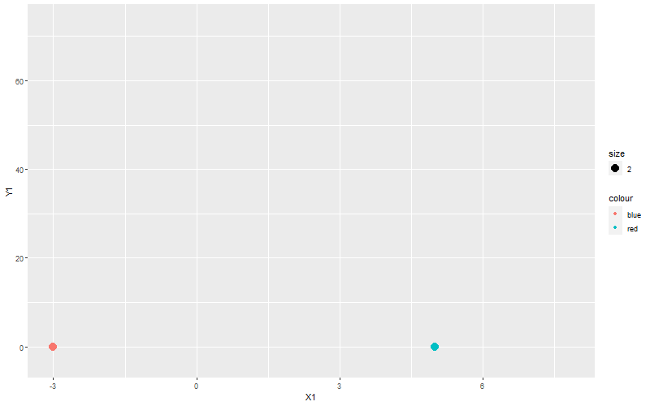

**Datas:** pasta 23/12/2022 · código 28/09/2022 (`Trabalho_1_236081`)

# Cálculo numérico

Trabalhos de disciplina: **sistemas lineares**, integração/ODE (órbitas), **equação do calor**, regressão polinomial por semana de demanda.

  
  

## O que o código faz

| Arquivo | Conteúdo |
|---------|----------|
| `TrabalhoII.Rmd`, `Trabalho_2_236081.Rmd` | Relatórios com implementações e gráficos (inclui GIFs `orbita*.gif`, `equacao_calor_*.gif`) |
| `Trabalho_1_236081/` | Entrega I (compactada em `CalculoNumerico.zip` / `.rar`) |
| `Imagens/` | Figuras usadas nos relatórios |

Trechos típicos: eliminação de Gauss, métodos iterativos, solvers para EDO, diferenças finitas para calor, `lm`/`poly` para tendência de demanda.

## Dados

| Arquivo | Uso |
|---------|-----|
| `calculo_numerico.xlsx`, `calculo_numerico2.xlsx` | Colunas `Semana` e `Demanda` para regressão polinomial |
| `matrix.xlsx` | Matrizes de exemplo para álgebra linear |
| `tabela.csv` | Tabela auxiliar (conferir no chunk que a referencia) |

## Como rodar

RStudio → working directory nesta pasta → abra o `Trabalho_*.Rmd` desejado → **Knit** (alguns chunks são pesados).
